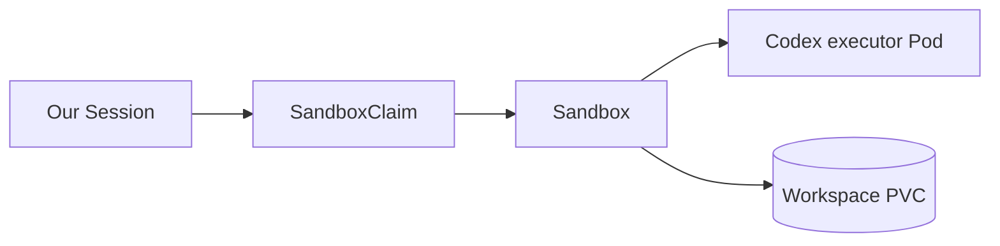

# Codex Session Operator

Run OpenAI managed coding agents against repositories in Kubernetes. Define an Agent, choose a Sandbox workspace, and send a task through a reusable Profile. The operator creates a Session for the conversation; the gateway saves its messages, history and approvals in PostgreSQL.

OpenAI runs the agent. [Kubernetes Agent Sandbox](https://agent-sandbox.sigs.k8s.io/) runs the executor and manages its workspace. This project connects them and tracks the conversation through provisioning, execution and cleanup.

## How it fits together


The animation walks through the self-hosted lifecycle below. [View the static overview](docs/assets/session-flow.png).

| Component | Responsibility |
| --- | --- |
| Our controller | Reconciles custom resources, manages OpenAI identities and requests Sandbox workspaces. |
| Our gateway | Accepts tasks, delivers messages, saves history and handles approvals. |
| Agent Sandbox | Creates and replaces executor Pods and manages workspace storage. |
| OpenAI | Runs the managed Agent and Session, including reasoning and tool requests. |
| PostgreSQL | Stores conversations, pending input and retry receipts. |

For self-hosted execution, the Kubernetes ownership chain is:



Our controller creates the claim. The separately installed Agent Sandbox operator creates the Sandbox, Pod and storage. The Pod runs `codex exec-server`, connects to OpenAI and executes the agent's commands against the repository. Use an application executor image with the tools your project needs; the Go example adds Go, Make, a C compiler and GitHub CLI.

Administrators define the image, repository revision, resources, security, Secret references and storage in a `SandboxTemplate`. A `SandboxWarmPool` selects that template. We use `replicas: 0` for on-demand allocation: each Session needs its own OpenAI connection settings and workspace.

We pin the Go dependency and deployment examples to **Agent Sandbox v1.0.7**. Install its core and extensions controllers and CRDs separately from our controller and gateway. See [deployment](docs/deployment.md#self-hosted-execution) for the setup.

## Get started

### Try the local demo

With Docker, Go, Make, Kind, kubectl, Python 3.10+, Node.js and OpenSSL installed, run:

```sh
make demo
```

This builds an isolated Kind deployment with the real Sandbox operator and a simulated OpenAI provider. It needs no API key and makes no model calls. The command retains the successful playground and prints client and cleanup instructions. `make test-e2e` runs the same suite and removes its cluster afterward.

### Run a real repository task

Follow [Run my-go-project](docs/my-go-project.md) to build the executor, install the services, configure credentials and ask an agent to fix a Go service. You need an OpenAI project with Agents API access, a separate restricted executor key and PostgreSQL. Model calls incur charges.

The [deployment guide](docs/deployment.md) covers installation in your own cluster. Install our controller and gateway together as separate Deployments; have your platform team provision and manage PostgreSQL externally, and install Agent Sandbox separately. The demo and local development helpers deploy PostgreSQL in Kubernetes for convenience. The gateway serves HTTP by default. Your deployment layer manages access control.

## Configuration

Our resources use `agents.softcane.io/v1alpha1` and namespaced references.

| Resource | What you configure |
| --- | --- |
| `Agent` | Model, instructions, reasoning settings and tools. |
| `Environment` | An approved Sandbox pool and workspace policy for self-hosted execution. It also supports OpenAI-hosted execution and no-runtime tasks. |
| `Profile` | Agent, Environment, optional Vault references and an explicit spending policy. Callers select a Profile when starting work. |
| `Session` | One conversation attempt, normally created by the gateway from a Profile. |
| `Vault` and `VaultCredential` | Provider tool credentials backed by Kubernetes Secret references. |

An Environment selects an administrator's approved pool:

```yaml
apiVersion: agents.softcane.io/v1alpha1
kind: Environment
metadata:
  name: go-development
  namespace: codex-session-operator-system
spec:
  mode: SelfHosted
  deletionPolicy: Delete
  selfHosted:
    sandboxPoolRef:
      name: my-go-project-v1
    workspace:
      directory: /workspace
      deletionPolicy: Retain
```

Approve the pool through the controller's `SANDBOX_POOLS` configuration. Keep managed template and pool specifications immutable; create a new versioned setup when their configuration changes. Applying an Agent, Environment and Profile creates no task Pod. Start a conversation through the gateway to use the Profile.

See the [complete example templates](examples/my-go-project/automation/k8s/) for the Agent, Environment, Profile, SandboxTemplate and SandboxWarmPool, and the [resource reference](docs/resources.md) for all supported fields.

## Task lifecycle

The animation shows these steps for a `SelfHosted` Environment:

1. **Install the services.** Deploy our controller and gateway together. Provision PostgreSQL and install the Agent Sandbox core and extensions separately.
2. **Declare the configuration.** Set up an Agent, Environment and Profile with an explicit spending policy. An administrator supplies a versioned SandboxTemplate and pool, approved through `SANDBOX_POOLS`. These declarations create no task Pod.
3. **Start a conversation.** Send a Profile name, message and stable idempotency key to the gateway.
4. **Save the input.** The gateway commits the request and receipt to PostgreSQL, then returns HTTP `202` with a conversation URL.
5. **Create the Kubernetes Session.** A gateway worker creates one Session from the accepted Profile selection.
6. **Create the remote Session.** The controller resolves Ready dependencies, freezes their identities and creation settings, and persists a creation claim before calling OpenAI.
7. **Request the workspace.** Our controller creates a Session-owned SandboxClaim. Agent Sandbox creates the Sandbox, executor Pod and workspace PVC from the approved recipe.
8. **Prepare and connect.** The template prepares the repository and starts `codex exec-server`. Input delivery waits for verified ownership, preparation, workspace identity and a current OpenAI connection.
9. **Run and read the result.** OpenAI runs the agent loop and requests tools from the executor. The gateway delivers messages, saves turns and handles approvals. Read the saved new root turn and its output to confirm its outcome.
10. **Continue or close.** Follow-up messages use the same conversation and workspace. Closing stops input and suspends execution before cleanup. After cleanup, an explicit start-fresh request creates a new Session and workspace.

HTTP `202` means the gateway accepted the input durably. Check a new completed root turn and its output to establish that the task finished. Keep the same idempotency key and request body when retrying an uncertain request.

A replacement executor reconnects to the same Session and persistent workspace. Closing stops new input and triggers cleanup. With `workspace.deletionPolicy: Delete`, cleanup removes the workspace. With `Retain`, cleanup leaves a suspended Sandbox and its files for administrative inspection. A fresh Session gets a separate workspace. PostgreSQL retains conversation history after Session cleanup.

## Development and reference

```sh
make lint
make test
make test-helpers
```

The [development guide](docs/development.md) covers database tests, isolated deployment tests and the separate paid OpenAI test. See [Contributing](CONTRIBUTING.md) for code changes and release checks.

To regenerate the GIF and static overview after lifecycle changes, install `Pillow>=10.4,<13` and run `python3 docs/assets/generate-session-flow.py`.

- [Architecture](docs/architecture.md): component boundaries, ownership and recovery.
- [Deployment](docs/deployment.md): prerequisites, credentials, installation and operations.
- [Conversations](docs/conversations.md): HTTP API, CLI, retries and approvals.
- [Resources](docs/resources.md): CRD configuration and examples.
- [CRD schemas](config/crd/bases/): accepted fields for this checkout.

## License

[Apache License 2.0](LICENSE).
