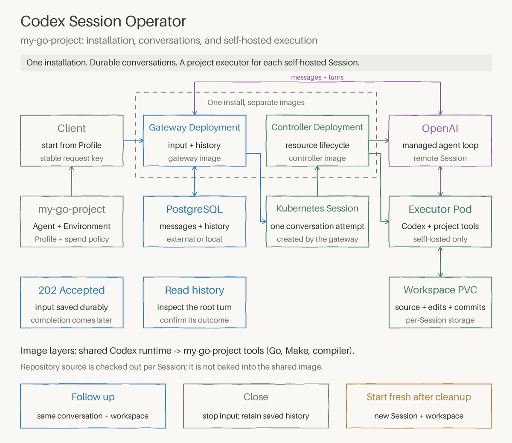

# Codex Session Operator

Run OpenAI coding agents against Git repositories in Kubernetes. Give an agent a task, let it work in an isolated workspace, and read the results through an HTTP API or CLI. Continue the conversation to keep working in the same workspace.

OpenAI runs the agent loop and model inference. Your cluster runs the commands and stores repository files through [Kubernetes Agent Sandbox](https://agent-sandbox.sigs.k8s.io/). The gateway saves messages, results and approvals in PostgreSQL.

The project is alpha. Real tasks require OpenAI Agents API access and incur API charges.

## Install

Release downloads install the operator and CLI without a source checkout, Go or Make. The commands below require a published release; replace `vX.Y.Z` with a tag from [Releases](https://github.com/softcane/codex-session-operator/releases).

```sh
# Latest stable release: CRDs, controller and gateway.
kubectl apply -f https://github.com/softcane/codex-session-operator/releases/latest/download/install.yaml

# Or pin a release for production and GitOps.
export VERSION=vX.Y.Z
kubectl apply -f "https://github.com/softcane/codex-session-operator/releases/download/${VERSION}/install.yaml"
```

Install Agent Sandbox separately at the tested version, then supply PostgreSQL and Secrets using the [installation guide](docs/deployment.md). The gateway uses HTTP by default.

For the CLI, download the archive for your machine. For example, on macOS with Apple Silicon:

```sh
curl -fsSLO https://github.com/softcane/codex-session-operator/releases/latest/download/gateway-client_darwin_arm64.tar.gz
tar -xzf gateway-client_darwin_arm64.tar.gz gateway-client
sudo install -m 0755 gateway-client /usr/local/bin/gateway-client
```

Archives are also available for `darwin_amd64`, `linux_amd64` and `linux_arm64`. To pin the CLI, replace `latest/download` with `download/${VERSION}`. Each release includes `SHA256SUMS`.

Follow [Run your first repository task](docs/getting-started.md) to download the matching example manifest, configure a workspace and send a task. Source builds are covered in [Contributing](CONTRIBUTING.md).

## How a task runs



[Static diagram](docs/assets/session-flow.png).

1. **Choose a Profile.** It selects the agent, workspace configuration and spending policy.
2. **Send a task.** The gateway saves your message and returns a conversation ID.
3. **Prepare the workspace.** The operator creates a Session. Agent Sandbox starts the executor and prepares the repository on persistent storage.
4. **Run the agent.** OpenAI directs the work; `codex exec-server` executes commands in your cluster.
5. **Read the result.** Inspect the saved turn, assistant output and command results. HTTP `202` means your message was accepted; completion comes later.
6. **Continue or close.** Follow-ups use the same workspace. Closing requests cleanup; the workspace policy controls whether files are deleted or retained. Saved conversation history remains in PostgreSQL.

## Example configuration

Create a `SandboxTemplate` and a `SandboxWarmPool`, then define an `Agent`, an `Environment` and a `Profile` in the same namespace. These examples use `sandbox-v1` for the workspace setup and are available together in [examples/repository-task.yaml](examples/repository-task.yaml).

### 1. Define the workspace

After [installation](docs/deployment.md), include `sandbox-v1` in the controller's `SANDBOX_POOLS` setting. Use the `codex-executor` Secret from the [Secret setup](docs/deployment.md#2-create-the-secrets) for the restricted environment key.

The template below prepares the public `google/uuid` repository and configures a Go executor for that checkout. Before applying it, replace the example image digest, select your node architecture and set a working StorageClass. The image must contain `codex exec-server`, `/workspace-bootstrap` and Go; the [application executor Dockerfile](examples/my-go-project/sandbox/Dockerfile.executor) builds that layer. The YAML image anchor lets both containers use the same image reference.

<details>
<summary>SandboxTemplate CR: sandbox-v1</summary>

```yaml
apiVersion: extensions.agents.x-k8s.io/v1beta1
kind: SandboxTemplate
metadata:
  name: sandbox-v1
  namespace: codex-session-operator-system
  labels:
    agents.softcane.io/managed: "true"
spec:
  envVarsInjectionPolicy: Allowed
  service: false
  podTemplate:
    spec:
      automountServiceAccountToken: false
      restartPolicy: Always
      terminationGracePeriodSeconds: 10
      nodeSelector:
        kubernetes.io/arch: arm64
      securityContext:
        runAsNonRoot: true
        runAsUser: 1000
        runAsGroup: 1000
        fsGroup: 1000
        seccompProfile: {type: RuntimeDefault}
      initContainers:
        - name: repository-prepare
          image: &executor_image registry.example/executor@sha256:aaaaaaaaaaaaaaaaaaaaaaaaaaaaaaaaaaaaaaaaaaaaaaaaaaaaaaaaaaaaaaaa
          imagePullPolicy: IfNotPresent
          command: [/workspace-bootstrap]
          args:
            - --storage-root
            - /workspace-storage
            - --session-uid
            - $(SESSION_UID)
            - --url
            - https://github.com/google/uuid.git
            - --commit
            - 0f11ee6918f41a04c201eceeadf612a377bc7fbc
          env:
            - name: TMPDIR
              value: /tmp
          securityContext: &restricted
            allowPrivilegeEscalation: false
            readOnlyRootFilesystem: true
            capabilities: {drop: [ALL]}
          resources:
            requests: {cpu: 100m, memory: 128Mi}
            limits: {cpu: "1", memory: 512Mi}
          volumeMounts:
            - {name: workspace, mountPath: /workspace-storage}
            - {name: tmp, mountPath: /tmp}
      containers:
        - name: executor
          image: *executor_image
          imagePullPolicy: IfNotPresent
          workingDir: /workspace
          command: [codex, exec-server]
          args: [--remote, $(CODEX_REMOTE_URL), --environment-id, $(CODEX_ENVIRONMENT_ID)]
          env:
            - name: CODEX_API_KEY
              valueFrom:
                secretKeyRef:
                  name: codex-executor
                  key: CODEX_API_KEY
          securityContext: *restricted
          resources:
            requests: {cpu: 250m, memory: 256Mi}
            limits: {cpu: "2", memory: 2Gi}
          volumeMounts:
            - {name: workspace, mountPath: /workspace, subPath: project}
            - {name: home, mountPath: /home/node}
            - {name: tmp, mountPath: /tmp}
      volumes:
        - name: home
          emptyDir: {sizeLimit: 128Mi}
        - name: tmp
          emptyDir: {sizeLimit: 1Gi}
  volumeClaimTemplates:
    - metadata:
        name: workspace
      spec:
        accessModes: [ReadWriteOnce]
        storageClassName: standard
        resources:
          requests: {storage: 1Gi}
```

</details>

The pool selects that template. With `replicas: 0`, Agent Sandbox allocates a workspace when a Session requests one.

```yaml
apiVersion: extensions.agents.x-k8s.io/v1beta1
kind: SandboxWarmPool
metadata:
  name: sandbox-v1
  namespace: codex-session-operator-system
  labels:
    agents.softcane.io/managed: "true"
spec:
  replicas: 0
  sandboxTemplateRef:
    name: sandbox-v1
```

Managed template and pool specifications are immutable. To change an installed recipe, create a new versioned pair and approve the new pool.

### 2. Define the agent and Profile

The Environment selects `sandbox-v1`; the Profile combines it with the Agent and spending policy.

```yaml
apiVersion: agents.softcane.io/v1alpha1
kind: Agent
metadata:
  name: sandbox-agent
  namespace: codex-session-operator-system
spec:
  model: gpt-6-luna
  instructions: Use the prepared repository and report actual commands and results.
  deletionPolicy: Delete
---
apiVersion: agents.softcane.io/v1alpha1
kind: Environment
metadata:
  name: sandbox-environment
  namespace: codex-session-operator-system
spec:
  mode: SelfHosted
  deletionPolicy: Delete
  selfHosted:
    sandboxPoolRef:
      name: sandbox-v1
    workspace:
      directory: /workspace
      deletionPolicy: Delete
---
apiVersion: agents.softcane.io/v1alpha1
kind: Profile
metadata:
  name: sandbox
  namespace: codex-session-operator-system
spec:
  agentRef:
    name: sandbox-agent
  environmentRef:
    name: sandbox-environment
  spendControl:
    mode: Unlimited
```

`Unlimited` permits paid inference without a per-Session dollar cap. To request a cap, use `mode: Limited` and `limitCents: 500` for US$5; this requires provider-project support.

Select the `sandbox` Profile when [sending a task](docs/getting-started.md#4-send-a-task). The gateway creates the `Session`; applying these CRs alone starts no task Pod. Follow-ups keep that Session and workspace. With the shown `Delete` policy, closing removes the workspace, so retrieve any changes first.

Optional `Vault` and `VaultCredential` CRs supply credentials for connected provider tools. See the [resource reference](docs/resources.md) for all six CRs, other execution modes and update rules.

## Documentation

- [Getting started](docs/getting-started.md) — install locally and run a real task.
- [Deployment](docs/deployment.md) — install and operate in your own cluster.
- [Conversations](docs/conversations.md) — CLI, HTTP API, retries and approvals.
- [Resources](docs/resources.md) — configuration fields and update rules.
- [Architecture](docs/architecture.md) — components, state and recovery.
- [Contributing](CONTRIBUTING.md) — builds, tests, simulated demo and releases.

Report vulnerabilities through [SECURITY.md](SECURITY.md). Licensed under [Apache 2.0](LICENSE).
