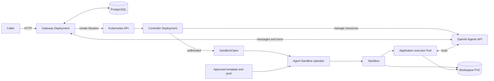
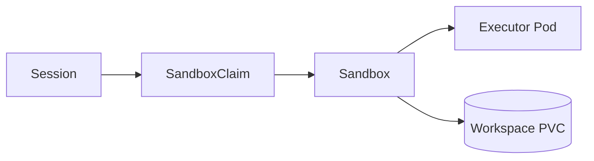

# Architecture

The system separates resource lifecycle from conversation state. The controller reconciles OpenAI identities and Kubernetes resources. The gateway accepts input, delivers messages and saves history in PostgreSQL. They run as separate Deployments and images, and ship together because a gateway-created conversation needs both services.

This guide explains those boundaries, how configuration becomes fixed for a Session, and how execution and cleanup recover from interruption. For setup steps, use [deployment](deployment.md); for request and response details, use [conversations](conversations.md).

## Deployment boundaries

| Boundary | Responsibility |
| --- | --- |
| Controller image and Deployment | CRD reconciliation, remote ownership, dependency snapshots, finalizers and Session-owned SandboxClaims. It has no conversation store. |
| Gateway image and Deployment | HTTP, Profile admission, durable input, delivery, saved history, approvals, and worker fencing. It does not reconcile executor resources directly. |
| Agent Sandbox operator | Separately installed controller for templates, pools, claims, Sandboxes, executor Pods and workspace storage. |
| PostgreSQL service | Durable gateway state. The platform team provisions and manages it externally to the operator. Demo and local development helpers deploy a Kubernetes instance for convenience. |
| Codex executor image | Shared `codex exec-server`, Git, repository preparation, and basic runtime tools. |
| Application executor image | Project-specific tools layered on the Codex executor. For `my-go-project`, these include Go, Make, a C compiler, and GitHub CLI. |
| Capability images | Versioned skills or plugins copied into the executor. They remain separate from the application executor image. |

The gateway serves HTTP and delegates authentication and access control to the deployment layer. Requests select their namespace in the URL; the gateway has no caller tokens or roles. Its public and controller RPC ports use HTTP by default; TLS can be configured explicitly or terminated at an ingress. PostgreSQL transport is configured independently through its connection URL.

Gateway replicas initialize a fresh schema from the embedded `schema.sql`. A PostgreSQL advisory lock serializes that first startup when several replicas start together. The gateway database role owns the schema and performs both initialization and runtime reads and writes.

## Configuration and Session identity

All six resources use `agents.softcane.io/v1alpha1` and belong to a Kubernetes namespace.

| Resource | Purpose |
| --- | --- |
| `Agent` | Reusable model, instructions and tool configuration backed by a remote Agent. |
| `Environment` | Runtime recipe: `None`, `OpenAIHosted` or `SelfHosted`. |
| `Vault` | Remote credential container. |
| `VaultCredential` | Credential metadata and a same-namespace Kubernetes Secret reference. |
| `Profile` | Same-namespace Agent, Environment, Vault references and explicit spending policy for future conversations. |
| `Session` | One conversation with an Agent, Environment, optional Vaults and explicit spend policy. |

A namespaced `Profile` CRD selects these references. Its controller publishes readiness and safe dependency identities without creating remote objects. The gateway reads Profiles and dependencies authoritatively for fresh admission; edits and additions take effect without a restart. A caller chooses a Profile and supplies a message. The caller cannot use the conversation API to override its sandbox setup, Secrets or spending policy.

Configuration becomes fixed at two boundaries:

1. **Gateway acceptance.** The gateway records the Profile UID, generation, resource version, policy digest and selected dependency UIDs. A later resource with the same name cannot replace an accepted dependency.
2. **Remote creation.** The controller resolves Ready dependencies, verifies the accepted identities and freezes their remote IDs and creation settings before creating the OpenAI Session.

Editing an Agent or Environment affects future Sessions. A Session can change its creation inputs until its durable creation claim is recorded. After that claim, supported updates are limited to model, reasoning effort, service tier, metadata and spending policy; the existing remote Session keeps its identity. See [update rules](resources.md#desired-state-updates-and-observation) for the admission and controller checks.

## From first message to saved outcome

1. A caller sends a profile and first message with an idempotency key.
2. The gateway commits the request and receipt to PostgreSQL, then returns `202` with a conversation URL.
3. The gateway worker creates a Session from the trusted profile.
4. The controller resolves dependencies, saves a creation claim and creates the owned remote Session. In `None` mode it obtains the durable first message through internal gateway RPC and includes it in remote creation.
5. The gateway observes that first submission, delivers later messages and saves provider turns and history. Public reads use the stored snapshot.
6. The caller reads the conversation to observe completion, add input or close it.

The public conversation ID exists before the Kubernetes Session UID. Closing a conversation stops fresh input and requests Session deletion. Cleanup can take time. After cleanup, an explicit restart creates a new attempt and conversation ID; the earlier attempt remains readable.

## Self-hosted execution and readiness

A direct Session uses the same controller lifecycle with resource references supplied by its caller. In `None` mode, remote creation waits for durable first input through the gateway. In `SelfHosted` mode, the controller creates the remote Session and requests execution through a SandboxClaim.

The Kubernetes ownership chain is:

The Session controller creates the claim. Agent Sandbox creates the Sandbox, Pod and storage, and can replace a missing Pod. The approved SandboxTemplate defines the executor image, preparation, resources, runtime isolation, Secret mounts and storage.

The gateway can accept input while provisioning is pending. Delivery waits for all of these observations:

- The verified Session → SandboxClaim → Sandbox → Pod ownership chain.
- Successful template-defined repository preparation.
- Matching current Pod, workspace and frozen configuration identities.
- Runtime readiness and a current OpenAI connection.

Sandbox or Pod health alone cannot establish readiness. A missing or replaced workspace invalidates delivery proof; an empty replacement disk is not recovered work. A replacement executor must reconnect to the same remote Session and persistent workspace before input resumes. Cancel and close remain available while delivery is held.

### Connection observations

Reconnection revokes the previous execution proof until the connection is observed again. An idle replacement may reconnect without producing a new connected event on an existing stream. While that stream remains subscribed, the controller can verify the prepared executor against OpenAI's current runtime status. It then rechecks the Session, Pod, process and workspace identities. A newer stream transition or lost subscription rejects the result.

### Conditions and updates

Session conditions describe independent observations. `RemoteSessionCreated` records remote existence, `ConfigurationCurrent` records configuration agreement, `WorkspacePrepared` records preparation, and `EnvironmentConnected` records the provider connection. Supported mutable updates preserve valid existence and execution evidence. A retained remote ID is recovery evidence; a current provider observation establishes whether the object exists.

Session status has no phase field. The gateway derives a display summary from conditions, while delivery uses current-generation conditions and verified identities. Neither readiness nor a display phase establishes that a turn completed; read the saved root turn and its output.

CEL admission rules freeze typed creation inputs. Opaque JSON Schemas have an unknown-key equality limitation, so the controller also compares frozen digests. An unsupported edit produces `ConfigurationCurrent=False` with `RequiresNewSession` and preserves the original remote Session. Revert the edit or create a new Session.

## State ownership

| Location | Stored state |
| --- | --- |
| Kubernetes | Desired configuration, remote IDs, conditions, safe dependency snapshots, creation claims and finalizers. |
| Gateway PostgreSQL | Messages, receipts, replay identities, pending delivery, conversation-to-Session mappings, saved turns and approvals. |
| OpenAI | Managed Agent and Session identities, reasoning and remote turns. |
| Executor workspace or PVC | Repository files, edits, local commits and task artifacts, with persistence configured in the SandboxTemplate. |

Conversation text and credential values do not belong in CR status. The executor workspace does not replace the gateway store.

## Recovery and cleanup

### Uncertain remote outcomes

Controllers persist a claim before creating a remote object. Agent, Session, Vault and VaultCredential recovery searches for the exact owned object using the Kubernetes UID and installation owner scope. Hosted Environment templates use bounded name-based audit candidates; an uncertain template create requires independent audit rather than automatic adoption. An uncertain result retains its claim and condition rather than starting another create.

### Gateway worker recovery

Gateway replicas can accept HTTP requests concurrently. One database lease selects the delivery worker; an increasing ownership epoch fences expired workers from saving results. The database cannot make a remote side effect atomic. External functions must recover or deduplicate their saved operation ID downstream.

### Session cleanup

Finalizers keep cleanup observable. The gateway stops input before remote cleanup. A Session always cleans up its owned remote conversation. `workspace.deletionPolicy: Delete` deletes its SandboxClaim and waits for cascade cleanup of compute and storage. `workspace.deletionPolicy: Retain` suspends the Sandbox, waits for its executor to stop, detaches the Sandbox from its claim, and deletes the claim so that the stopped Sandbox and its files remain. Retained Sandboxes need explicit administrative removal and backups. An uncertain remote delete keeps its finalizer until the outcome is known.

### Executor and workspace recovery

Administrators maintain approved SandboxTemplates and SandboxWarmPools. Templates own the executor image, init containers, repository revision, resources, runtime isolation, Secret mounts and storage. Pools use `replicas: 0` for on-demand allocation; their templates set `envVarsInjectionPolicy: Allowed` to accept Session connection settings. The controller creates claims injecting the remote environment ID, remote URL and Session UID. These values bind a newly created executor to its Session; credential values remain in Secret references within the template. Session-specific injection deliberately takes the fresh-creation path rather than claiming a prestarted spare.

The operator verifies the claim, Sandbox, Pod and workspace identities before recording execution readiness. Agent Sandbox can recreate a missing Pod; the executor reconnects to the same remote Session and persistent workspace. Repository preparation belongs in the administrator's template. The supplied template uses `/workspace-bootstrap` to validate a pinned project and Session marker, preserving existing edits and commits during Pod replacement. A replaced or missing workspace invalidates delivery proof; a newly allocated empty disk is not treated as recovered work. Sandbox readiness alone does not establish preparation or an OpenAI connection.

## Source map

| Path | Responsibility |
| --- | --- |
| `api/v1alpha1/` | CRD API source. |
| `internal/controller/` | Reconciliation, ownership, snapshots and cleanup. |
| `internal/openaiapi/` | OpenAI adapter and configuration conversion. |
| `internal/gateway/` | HTTP, persistence, delivery and approvals. |
| `internal/sandbox/` | Approved pool validation, claim construction and executor ownership verification. |
| `config/` | Deployment overlays and resource examples. |
| `examples/my-go-project/` | Application executor, skills bundle and CRD templates for the repository task walkthrough. |
| `test/e2e/` | Isolated simulated-provider deployment test and demo client. |

See [resources](resources.md) for CRD examples, [conversations](conversations.md) for the HTTP contract and [deployment](deployment.md) for credentials, storage and current limits.
