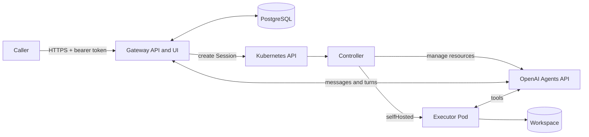

# Architecture

The controller manages the declared lifecycle of an OpenAI Session. The gateway handles its conversation. PostgreSQL stores accepted input, receipts, history and approvals so gateway replicas can recover after a restart.

## Resources

All five resources use `agents.softcane.io/v1alpha1` and belong to a Kubernetes namespace.

| Resource | Purpose |
| --- | --- |
| `Agent` | Reusable model, instructions and tool configuration backed by a remote Agent. |
| `Environment` | Runtime recipe: `none`, `openaiHosted` or `selfHosted`. |
| `Vault` | Remote credential container. |
| `VaultCredential` | Credential metadata and a same-namespace Kubernetes Secret reference. |
| `Session` | One conversation with an Agent, Environment, optional Vaults and explicit spend policy. |

A profile in the gateway is a trusted `WorkRoute` that selects these references. A caller chooses a profile and supplies a message. The caller cannot use the conversation API to override its image, Secret or spending policy.

The controller resolves Ready dependencies and freezes their remote identities and creation settings before creating a Session. Editing an Agent or Environment affects future Sessions. A new Session requires same-namespace `agentRef` and `environmentRef`, plus `spendControl`.

## First message to completed turn

1. A caller sends a profile and first message with an idempotency key.
2. The gateway commits the request and receipt to PostgreSQL, then returns `202` with a conversation URL.
3. The gateway worker creates a Session from the trusted profile.
4. The controller resolves dependencies, saves a creation claim and creates the owned remote Session.
5. The gateway delivers later messages and saves provider turns and history.
6. The caller reads the conversation to observe completion, add input or close it.

The public conversation ID exists before the Kubernetes Session UID. Closing a conversation stops fresh input and requests Session deletion. Cleanup can take time. After cleanup, an explicit restart creates a new attempt and conversation ID; the earlier attempt remains readable.

A direct Session follows the same controller lifecycle without a profile. In `none` mode, remote creation waits for durable first input through the gateway. In `selfHosted` mode, the controller creates the remote Session and provisions its executor before the first message.

## State ownership

| Location | Stored state |
| --- | --- |
| Kubernetes | Desired configuration, remote IDs, conditions, safe dependency snapshots, creation claims and finalizers. |
| Gateway PostgreSQL | Messages, receipts, replay identities, pending delivery, work mappings, saved turns and approvals. |
| OpenAI | Managed Agent and Session identities, reasoning and remote turns. |
| Executor workspace | Files from self-hosted tool execution, with persistence selected by the Environment. |

Conversation text and credential values do not belong in CR status. The executor workspace does not replace the gateway store.

## Recovery

Controllers persist a claim before creating a remote object. When a create response is lost, they search for the exact owned object using the Kubernetes UID and installation owner scope. An uncertain result retains its claim and condition rather than starting another create.

Gateway replicas can accept HTTP requests concurrently. One database lease selects the delivery worker; an increasing ownership epoch fences expired workers from saving results. The database cannot make a remote side effect atomic. External functions must recover or deduplicate their saved operation ID downstream.

Finalizers keep cleanup observable. The gateway stops input before remote cleanup. `Delete` and `Retain` policies control dependency and workspace cleanup; an uncertain remote delete keeps its finalizer until the outcome is known.

The controller ties executor Pods and workspace claims to the Session UID and validates approved image digests and StorageClasses. A replacement Pod can keep the same remote Session. Files survive replacement only when the Environment requested a persistent workspace. A retained PVC still needs an independent backup policy.

## Source map

| Path | Responsibility |
| --- | --- |
| `api/v1alpha1/` | CRD API source. |
| `internal/controller/` | Reconciliation, ownership, snapshots and cleanup. |
| `internal/openaiapi/` | OpenAI adapter and configuration conversion. |
| `internal/gateway/` | HTTP/UI, persistence, delivery and approvals. |
| `internal/sandbox/` | Executor Pod and workspace construction. |
| `config/` | Deployment overlays and resource examples. |
| `test/e2e/` | Isolated simulated-provider deployment test and demo client. |

See [conversations](conversations.md) for the HTTP contract and [deployment](deployment.md) for credentials, storage and current limits.
