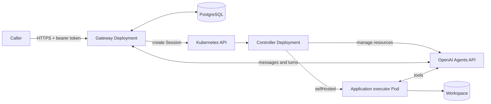

# Architecture

The controller manages the declared lifecycle of OpenAI and Kubernetes resources. The gateway manages conversations. They run as separate Deployments and images, but ship as one installation because every gateway-created conversation depends on both services. PostgreSQL stores accepted input, receipts, history, and approvals so gateway replicas can recover after a restart.

## Deployment boundaries

| Boundary | Responsibility |
| --- | --- |
| Controller image and Deployment | CRD reconciliation, remote ownership, dependency snapshots, finalizers, executor Pods, and workspace claims. It has no conversation store. |
| Gateway image and Deployment | Authenticated HTTP, Profile admission, durable input, delivery, saved history, approvals, and worker fencing. It does not reconcile executor resources directly. |
| PostgreSQL service | Durable gateway state. It is provisioned outside the combined installation and may be managed infrastructure or a local development instance. |
| Codex executor image | Shared `codex exec-server`, Git, repository preparation, and basic runtime tools. |
| Application executor image | Project-specific tools layered on the Codex executor. For `my-go-project`, these include Go, Make, a C compiler, and GitHub CLI. |
| Capability images | Versioned skills or plugins copied into the executor. They remain separate from the application executor image. |

Gateway replicas initialize a fresh schema from the embedded `schema.sql`. A PostgreSQL advisory lock serializes that first startup when several replicas start together. The gateway database role owns the schema and performs both initialization and runtime reads and writes.

## Resources

All six resources use `agents.softcane.io/v1alpha1` and belong to a Kubernetes namespace.

| Resource | Purpose |
| --- | --- |
| `Agent` | Reusable model, instructions and tool configuration backed by a remote Agent. |
| `Environment` | Runtime recipe: `none`, `openaiHosted` or `selfHosted`. |
| `Vault` | Remote credential container. |
| `VaultCredential` | Credential metadata and a same-namespace Kubernetes Secret reference. |
| `Profile` | Same-namespace Agent, Environment, Vault references and explicit spending policy for future conversations. |
| `Session` | One conversation with an Agent, Environment, optional Vaults and explicit spend policy. |

A namespaced `Profile` CRD selects these references. Its controller publishes readiness and safe dependency identities without creating remote objects. The gateway reads Profiles and dependencies authoritatively for fresh admission; edits and additions take effect without a restart. A caller chooses a Profile and supplies a message. The caller cannot use the conversation API to override its image, Secret or spending policy.

The gateway freezes Profile UID, generation, resource version, policy digest and selected dependency UIDs when it accepts an attempt. The controller verifies those identities again while resolving Ready dependencies and freezing their remote identities and creation settings before creating a Session. Editing an Agent or Environment affects future Sessions. Selected Session fields, including model, reasoning effort, service tier, metadata and spend policy, support explicit updates. A new Session requires same-namespace `agentRef` and `environmentRef`, plus `spendControl`.

## First message to completed turn

1. A caller sends a profile and first message with an idempotency key.
2. The gateway commits the request and receipt to PostgreSQL, then returns `202` with a conversation URL.
3. The gateway worker creates a Session from the trusted profile.
4. The controller resolves dependencies, saves a creation claim and creates the owned remote Session. In `none` mode it obtains the durable first message through internal gateway RPC and includes it in remote creation.
5. The gateway observes that first submission, delivers later messages and saves provider turns and history. Public reads use the stored snapshot.
6. The caller reads the conversation to observe completion, add input or close it.

The public conversation ID exists before the Kubernetes Session UID. Closing a conversation stops fresh input and requests Session deletion. Cleanup can take time. After cleanup, an explicit restart creates a new attempt and conversation ID; the earlier attempt remains readable.

A direct Session follows the same controller lifecycle without a profile. In `none` mode, remote creation waits for durable first input through the gateway. In `selfHosted` mode, the controller creates the remote Session and provisions its executor before delivering input. The gateway can accept input while provisioning is pending. Self-hosted delivery requires the current Session-owned Pod, successful repository preparation, matching Pod/PVC/config identities, runtime readiness and a current remote connection. Reconnection revokes the old compute proof until re-observed; cancellation and cleanup remain available while delivery is held.

An idle replacement can reconnect without producing a new connected event on an existing stream. The controller can then verify the prepared executor against OpenAI's current runtime status while its stream remains subscribed. It rechecks Session, Pod, process and workspace identities after that read; a newer stream transition or lost subscription rejects the result. Pod health alone cannot establish a remote connection.

## State ownership

| Location | Stored state |
| --- | --- |
| Kubernetes | Desired configuration, remote IDs, conditions, safe dependency snapshots, creation claims and finalizers. |
| Gateway PostgreSQL | Messages, receipts, replay identities, pending delivery, conversation-to-Session mappings, saved turns and approvals. |
| OpenAI | Managed Agent and Session identities, reasoning and remote turns. |
| Executor workspace or PVC | Repository files, edits, local commits and task artifacts, with persistence selected by the Environment. |

Conversation text and credential values do not belong in CR status. The executor workspace does not replace the gateway store.

## Recovery

Controllers persist a claim before creating a remote object. Agent, Session, Vault and VaultCredential recovery searches for the exact owned object using the Kubernetes UID and installation owner scope. Hosted Environment templates use bounded name-based audit candidates; an uncertain template create requires independent audit rather than automatic adoption. An uncertain result retains its claim and condition rather than starting another create.

Gateway replicas can accept HTTP requests concurrently. One database lease selects the delivery worker; an increasing ownership epoch fences expired workers from saving results. The database cannot make a remote side effect atomic. External functions must recover or deduplicate their saved operation ID downstream.

Finalizers keep cleanup observable. The gateway stops input before remote cleanup. A Session always cleans up its owned remote conversation and executor. Reusable resources have `Delete`/`Retain` policies; the workspace's separate `claimDeletionPolicy` controls PVC cleanup. An uncertain remote delete keeps its finalizer until the outcome is known.

The controller ties executor Pods and workspace claims to the Session UID and validates approved image digests and StorageClasses. A replacement Pod can keep the same remote Session. Files survive replacement only when the Environment requested a persistent workspace. A pinned approved HTTPS repository is prepared by an init container into a project subtree. A marker outside that subtree ties initial preparation to the Session UID and repository digest; a replacement preserves dirty files and local commits. Repository credentials are mounted into preparation by default, separately from the executor key. Explicit `repository.mountCredentialsInExecutor: true` also mounts the selected files read-only into the executor for authorized publishing tools. The controller revokes execution when that credential source is unavailable or its frozen UID changes; rotation on the same Secret replaces the executor. A retained PVC has no Session owner reference and does not automatically attach to a new Session; it still needs an independent backup policy.

## Source map

| Path | Responsibility |
| --- | --- |
| `api/v1alpha1/` | CRD API source. |
| `internal/controller/` | Reconciliation, ownership, snapshots and cleanup. |
| `internal/openaiapi/` | OpenAI adapter and configuration conversion. |
| `internal/gateway/` | HTTP, persistence, delivery and approvals. |
| `internal/sandbox/` | Executor Pod and workspace construction. |
| `config/` | Deployment overlays and resource examples. |
| `examples/my-go-project/` | Application executor, skills bundle and CRD templates for the repository task walkthrough. |
| `test/e2e/` | Isolated simulated-provider deployment test and demo client. |

See [resources](resources.md) for CRD examples, [conversations](conversations.md) for the HTTP contract and [deployment](deployment.md) for credentials, storage and current limits.
