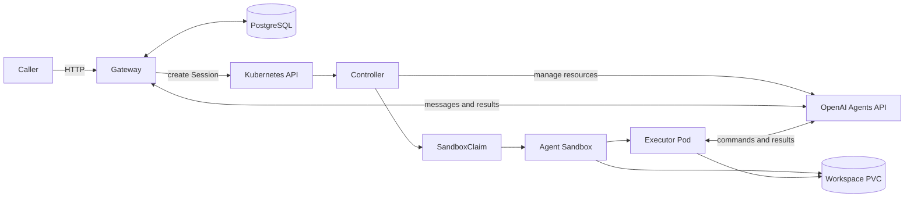

# Architecture

The controller manages Kubernetes and OpenAI resources. The gateway accepts tasks and saves conversations in PostgreSQL. They ship together as separate Deployments and images.

For a runnable setup, use [getting started](getting-started.md). This page explains the boundaries that matter when operating or changing the system.

## Component boundaries

| Component | Owns |
| --- | --- |
| Controller | Remote identities, dependency snapshots, creation claims, finalizers and Session-owned SandboxClaims. |
| Gateway | HTTP, Profile admission, saved input/history/approvals and delivery workers. |
| Agent Sandbox | Sandbox templates and pools, Sandboxes, executor Pods and workspace PVCs. Installed separately. |
| PostgreSQL | Durable conversations and replay receipts. Provisioned separately; local helpers supply a disposable instance. |
| Executor image | `codex exec-server`, Git and repository preparation. Application images add project tools; capability images supply skills or plugins. |

The gateway serves HTTP by default. Your ingress, proxy or network policy supplies access control; the gateway has no caller authentication or roles. All callers reaching a namespace's routes share its conversations.

## Configuration and identity

A `Profile` selects same-namespace Agent, Environment and optional Vault resources, plus a spending policy. Applying a Profile creates no task compute. Starting a conversation records its Profile and dependency identities before a worker creates the Session.

The controller resolves Ready dependencies and freezes their remote IDs and creation settings before creating the OpenAI Session. A same-name replacement cannot substitute a different dependency. Supported later changes are listed in [Session update rules](resources.md#session-update-rules).

In `None` mode, the controller waits for durable first input from the gateway and includes it in remote Session creation. In `SelfHosted` mode, it requests execution through the ownership chain `Session → SandboxClaim → Sandbox → Pod`, with a Sandbox-owned workspace PVC.

## Execution readiness

The gateway can save input while provisioning is pending. Delivery waits for verified ownership, successful repository preparation, the expected workspace and a current OpenAI connection. A healthy Pod alone is insufficient.

Administrators define images, repository commits, Secret mounts, resources and storage in versioned Sandbox templates and pools. The controller's `SANDBOX_POOLS` approves exact pool names. Session connection settings are injected into a fresh claim; credentials remain in template Secret references. This integration allocates on demand, even if a pool has spare Pods.

A replacement executor reconnects to the same Session and persistent workspace. Preparation validates the saved repository/Session marker and preserves edits and commits. A missing or replaced workspace holds delivery; an empty disk cannot substitute for recovered work. Connection changes revoke readiness until the current connection and execution identities are verified again.

Session conditions describe separate observations: `RemoteSessionCreated`, `ConfigurationCurrent`, `WorkspacePrepared` and `EnvironmentConnected`. Consumers check `observedGeneration`. The gateway's display phase and Session readiness do not establish task completion; read root-turn history.

## State ownership

| Location | Stored state |
| --- | --- |
| Kubernetes | Desired configuration, remote IDs, conditions, safe snapshots, creation claims and finalizers. |
| Gateway PostgreSQL | Messages, receipts, replay identities, pending input, attempt mappings, saved turns and approvals. |
| OpenAI | Managed Agent and Session identities and remote turns. |
| Workspace PVC | Repository files, edits, commits and task artifacts. |

Conversation content and credential values stay out of CR status. PostgreSQL and workspace storage need separate backups.

## Recovery and cleanup

Before remote creation, controllers persist a one-time claim. Agent, Session, Vault and VaultCredential recovery uses the Kubernetes UID and verified installation owner scope. Hosted Environment creation needs an independent audit after an uncertain result. Claims and finalizers remain until uncertain outcomes are resolved.

Gateway replicas accept requests concurrently. A database lease elects one delivery worker, and an increasing ownership epoch prevents expired workers from saving results. External functions must deduplicate their saved operation IDs; a database transaction cannot make a remote side effect atomic. Gateway replicas initialize a fresh schema under a PostgreSQL advisory lock.

Closing stops fresh input and requests Session deletion. Cleanup always removes the owned remote Session. Workspace policy then controls execution-resource cleanup:

- `Delete`: remove the claim and wait for dependent compute and storage to disappear.
- `Retain`: suspend the Sandbox, wait for its Pod to disappear, detach it from the claim, then delete the claim. Administrators keep the stopped Sandbox and files until they explicitly delete it.

Both policies remove the claim. A retained workspace does not attach to a later Session. Saved conversation history remains in PostgreSQL. Uncertain deletion keeps the finalizer and blocks completed cleanup.

## Source map

| Path | Responsibility |
| --- | --- |
| `api/v1alpha1/` | CRD API source. |
| `internal/controller/` | Reconciliation, ownership, snapshots and cleanup. |
| `internal/openaiapi/` | OpenAI adapter and configuration conversion. |
| `internal/gateway/` | HTTP, persistence, delivery and approvals. |
| `internal/sandbox/` | Approved pool validation, claim construction and executor ownership verification. |
| `config/` | Deployment overlays and resource examples. |
| `examples/my-go-project/` | Application executor, skills bundle and CRD templates for custom application setups. |
| `test/e2e/` | Isolated simulated-provider deployment test and demo client. |

See [resources](resources.md) for CRD examples, [conversations](conversations.md) for the HTTP contract and [deployment](deployment.md) for credentials, storage and current limits.
